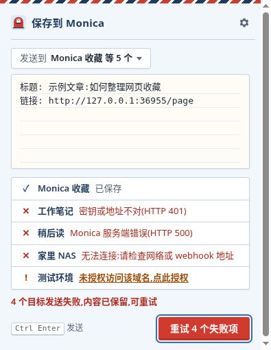
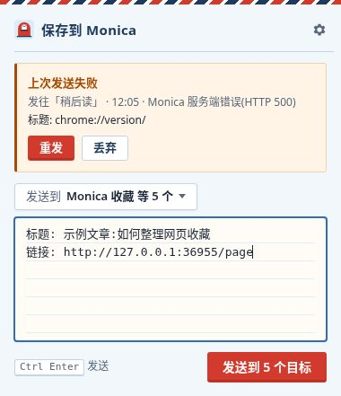

# Monica Chrome Save

Chrome Manifest V3 extension that saves the current tab (title + URL, optional notes/selection) to **the same Monica ingest webhook** as the iOS Shortcut. Since 2.0 you can configure several named webhooks and pick the target per save.

Protocol (do not invent another):

- `POST` to the user-configured webhook URL
- Header: `Authorization: Bearer <webhook_key>`
- Body JSON **only**: `{ "content": "..." }`

```
标题: {title}
链接: {url}

{selection_or_empty}
```

If nothing is selected, title + URL are still sent.

This extension does **not** write to Feishu and does **not** change Monica routines.

 

## Load unpacked (macOS and Windows)

Chrome steps are the same on both operating systems; only the folder picker looks different.

1. Clone or download this repo and keep the folder together (`manifest.json` must be at the folder root you select).
2. Open Chrome (or Edge).
3. Go to `chrome://extensions` (Edge: `edge://extensions`).
4. Turn **Developer mode** on (top right).
5. Click **Load unpacked**.
6. Select this repository folder (the one that contains `manifest.json`).
   - **Mac:** Finder dialog — navigate to the clone, select the folder, Open.
   - **Windows:** Explorer dialog — navigate to the clone, select the folder, Select Folder.

The toolbar gets the Monica Chrome Save icon (red mailbox on a light sky tile, a white letter going into the navy slot). Pin it from the puzzle-piece menu if it is hidden.

Reload the extension on `chrome://extensions` after you pull updates.

## Configure webhooks

1. On `chrome://extensions`, click **Details → Extension options**, or right-click the toolbar icon → **Options** (the popup's gear button opens it too).
2. Click **添加 webhook** and fill in:
   - **名称** — required and unique in the list (case-insensitive), e.g. `Monica 收藏`, `工作笔记`.
   - **Webhook URL** — `http://` or `https://`.
   - **Bearer key** — stored only in this browser profile.
3. Click **保存**. Chrome asks for permission to contact **that webhook's origin** — allow it.
4. Each row has its own **测试** button. It shows the **HTTP status only** (for example `HTTP 200`), never the key or the response body.

Other list actions:

- **编辑** — the key field stays empty; leave it empty to keep the stored key.
- **设为默认** — the default webhook is preselected in the popup and marked in the context menu. The first webhook you add becomes the default.
- **删除** — asks for confirmation. If no other webhook uses the same origin, the host permission for that origin is released.

**Upgrading from 1.x:** the old single URL + key are migrated automatically on update into a default webhook named **Monica**; the old storage keys are removed. The migration is idempotent.

## How to save

Toolbar icon click does **not** send immediately. It opens a compose popup.

| Trigger | What happens |
| --- | --- |
| Toolbar icon | Opens the popup. The textarea is prefilled with the current tab title + URL in the template above (plus selected text if the page allows it). Edit or add notes, then **发送**. |
| `Alt+Shift+S` | Same as the toolbar icon: opens (or focuses) the popup. Mac: Option+Shift+S. |
| `Cmd+Enter` / `Ctrl+Enter` in the popup | Sends. |
| Right-click page / selection / link | One webhook: **Save to Monica**. Several: **Save to ▸ {名称}** (default marked `(默认)`). Immediate save, no popup. There is no "Save to all". |

Right-click on a link saves the current page title + **that link's href**. Selection is appended when present.

### Popup targets

- With one webhook the popup shows `发送到 {名称}`.
- With several, **发送到 ▾** opens a checklist. The default webhook is preselected the first time; after that the popup remembers your last selection.
- Ticking several targets sends to them **one by one**, in list order, and shows a result row per target.

### Feedback

| State | Popup | Right-click |
| --- | --- | --- |
| Sending | Button shows a spinner and is disabled (no double submit); textarea is read-only | — |
| Success | Blue ✓ `已保存到「名称」`, popup closes after 0.9 s | Blue badge `OK` (clears after ~3 s), toast, tooltip |
| Failure | Brick-red reason per target (orange for permission/config warnings), content kept, button becomes **重试** (retries failed targets only) | Red (or orange) badge with the status code (or `ERR` / `PERM` / `CFG`), toast, tooltip; the content is kept for resend |

Failure reasons (always with the HTTP code when there is one; never the key or the response body):

| Cause | Text |
| --- | --- |
| 401 / 403 | 密钥或地址不对(HTTP 401) |
| 404 | 地址不存在(HTTP 404) |
| 429 | 请求过多,稍后再试(HTTP 429) |
| 5xx | Monica 服务端错误(HTTP 500) |
| Timeout (15 s) | 无法连接:请求超时(15 秒) |
| Network error | 无法连接:请检查网络或 webhook 地址 |
| Origin not granted | 未授权访问该域名,点此授权 (the popup link asks Chrome for that origin and retries) |

Requests are aborted after **15 seconds** (`AbortController`) and count as failures.

### Kept failures

When a right-click save fails, the extension stores **only the most recent failure** in `chrome.storage.local`: the content, the target webhook id, the time and the error kind/status. No key, no response body, no history. The failure badge stays until you open the popup, which shows **上次发送失败** with **重发** (resend to the same webhook) and **丢弃**.

### Restricted pages

Chrome does not let extensions script `chrome://` pages, the Chrome Web Store, and similar pages, so no toast can be drawn there. Right-click results on those pages are reported through the toolbar badge and the icon **tooltip** (hover the icon) only. No extra permission (such as `notifications`) is used.

## Privacy

- Webhook names, URLs and Bearer keys are stored in `chrome.storage.local` for **this browser profile only**.
- Keys are **not** written to git, screenshots in this repo, logs, or any file on disk besides Chrome's own extension storage, and are never shown again after saving.
- A key is sent only as the `Authorization` header to the webhook URL it belongs to.
- **测试** displays the HTTP status only.
- The last failed right-click save (content + webhook id + time + error) is kept locally until it is resent or discarded.
- This extension does not scrape page HTML for summarization. Monica handles digestion when a link is in `content`.

See [PRIVACY.md](PRIVACY.md).

## Permissions

Required (always), unchanged since 1.x:

| Permission | Why |
| --- | --- |
| `activeTab` | Read the tab you just invoked (toolbar popup, shortcut, or context menu). |
| `storage` | Save the webhook list, the popup's last target selection and the last failed save in `chrome.storage.local`. |
| `contextMenus` | "Save to Monica" / "Save to ▸ {名称}" on page / link / selection. |
| `scripting` | MV3 needs this to read `window.getSelection()` (popup prefill and context menus) and to draw a toast **on the tab you invoked**. It is not an always-on content script. |

Host access is **not** granted up front:

- Manifest uses `optional_host_permissions` for `https://*/*` and `http://*/*` so any webhook origin can be requested later.
- On **保存** or **测试**, the options page calls `chrome.permissions.request` for **that webhook's origin only** (`https://host:port/*`). Each webhook origin is requested separately.
- Deleting (or re-pointing) a webhook calls `chrome.permissions.remove` for its origin when no remaining webhook uses it.
- The service worker checks the grant before `fetch`. If the origin is not granted, the save fails with `未授权访问该域名` instead of a silent network error.

No `<all_urls>` required host permission. No Feishu API permission.

## Troubleshooting

- **CFG / 还没有 webhook** — open Options and add a webhook.
- **PERM / 未授权访问该域名** — click the link in the popup, or open Options and click **测试** (or **编辑 → 保存**) on that webhook and accept the prompt.
- **401 / 403 · 密钥或地址不对** — key or webhook URL is wrong; **测试** shows the status only.
- **无法连接** — URL typo, offline, server not answering within 15 s, or mixed-content/http issues.
- **No toast on `chrome://` or the Web Store** — expected; check the badge and hover the icon for the tooltip. The popup can still send whatever you type.
- **Shortcut does nothing** — set **Activate the extension** under `chrome://extensions/shortcuts`.
- **Popup has no URL** — some restricted pages do not expose a tab URL; you can still type content and send.

### Keyboard shortcut (MV3)

The shortcut is bound to Chrome's reserved `_execute_action` command, not a custom "save now" command. That is the Manifest V3 way to open the toolbar popup with a key — the same surface as clicking the icon, so the textarea is filled and focused.

Change or confirm it at `chrome://extensions/shortcuts`. Chrome lists `_execute_action` as **Activate the extension**. Chrome may ignore the suggested key if another extension already claimed it.

`chrome.action.onClicked` is unused: with `default_popup` set, Chrome never fires it.

## Development

Vanilla JS, no build step, no dependencies.

| Path | Role |
| --- | --- |
| `background.js` | Service worker (`"type": "module"`): wires install/migration, menu rebuilds, popup send messages, menu clicks. |
| `lib/protocol.js` | Shared ingest protocol (`buildContent`, `parseWebhookUrl`, `isConfigured`, `postToMonica` with 15 s timeout). |
| `lib/webhooks.js` | Pure webhook-list model: validation, add/edit/remove, default, origin bookkeeping, v1 migration plan. |
| `lib/store.js` | `chrome.storage.local` I/O for the list (runs the migration lazily) and the popup's last selection. |
| `lib/deliver.js` | Send to one stored webhook (permission check + POST). |
| `lib/feedback.js` | Result → user-facing text / badge. |
| `lib/failure.js` | The single kept failure record. |
| `lib/menus.js`, `lib/menu-save.js`, `lib/toolbar.js` | Context-menu layout, context-menu save, badge + tooltip. |
| `styles/ui.css` | Design tokens and base controls shared by `popup.*` and `options.*` (light theme only, see [Look](#look)). |
| `icons/logo.svg` | Logo source. `python3 scripts/generate-icons.py` renders `icons/icon{16,32,48,128}.png` and the 1024 px store master `icons/logo-1024.png` (gitignored) with ffmpeg + librsvg. |

Unit tests (Node 18+):

```bash
node --test
```

End-to-end run (needs Google Chrome; set `CHROME_BIN` to use another binary):

```bash
node tests/e2e/screenshots.mjs
```

It loads the real extension into headless Chrome over a CDP pipe (`Extensions.loadUnpacked`), points webhooks at a local mock server (`tests/e2e/mock-server.mjs`: 200 / 401 / 500 / never-answers / dropped connection), upgrades a configured 1.1.0 install in place to check the migration, drives the popup, options and the context-menu save path, asserts the outcomes and writes `docs/screenshots/*.jpg` plus `docs/screenshots/e2e-log.json`. Limits: the temp copy of the extension grants `http://127.0.0.1/*` up front because headless Chrome cannot answer permission prompts; headless Chrome has no toolbar or native context menu, so the badge and tooltip are read back through `chrome.action`, and menu clicks call the same `saveFromMenu()` the `onClicked` listener uses. Only dummy keys are used.

Do not commit `.pem`, `.crx`, `.env`, or key files (see `.gitignore`).

### Look

Simple retro post office, light theme only (no dark mode): a pale sky ground with white and cream paper, mailbox red `#D23A2D` for primary buttons, the logo and stamp marks, navy `#1F3A5F` ink and thin sky rules. Details are kept small: an airmail stripe along the top edge, ruled letter paper for the compose box, the logo as a perforated stamp, an outlined stamp tag for the default webhook, dashed tear lines between list rows. Status colors avoid green: success postal blue `#1F4E8C`, failure brick red `#B8281C`, warning burnt orange `#A64B06` (popup, badge and toast share them). System fonts only; nothing is loaded from the network.
